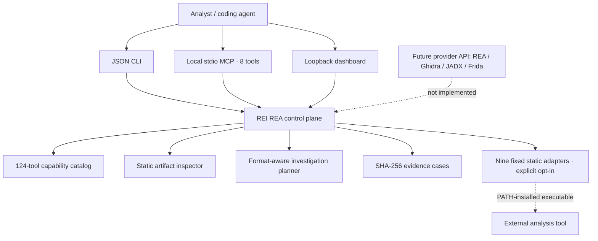

# REI REA

### Evidence-first reverse engineering. One workbench. Verifiable findings.

[](https://github.com/rootcastleco/Rei-Reverse-engineer-/actions/workflows/ci.yml)
[](https://www.python.org/)
[](#connect-an-ai-coding-agent)
[](LICENSE)
[](CHANGELOG.md)

**REI REA (Rootcastle Reverse Engineering Workbench)** gives developers and security researchers a consistent starting point for inspecting software artifacts, finding suitable analysis tools, and recording what the evidence actually supports.

It brings together a **124-entry reverse-engineering tool catalog**, **read-only artifact triage**, **SHA-256 evidence cases**, a **JSON command-line interface**, a local **Model Context Protocol (MCP) server**, a **loopback dashboard**, and **10 specialist AI-agent skills**.

The objective is not to produce confident-looking pseudocode. It is to make each conclusion **traceable, testable, and reproducible**.

> [!IMPORTANT]
> **Alpha scope, stated precisely.** REI REA is an original Rootcastle implementation, not an official fork or feature-parity replacement of [morluto/rea](https://github.com/morluto/rea). A catalog entry does **not** mean a tool is installed, integrated, or validated. Nine fixed static CLI adapters are implemented. External decompilers, debuggers, mobile instrumentation systems, and the upstream REA server are **not included**. See [Capabilities and limitations](#capabilities-and-limitations).

**[Quick start](#quick-start)** · **[Capabilities](#capabilities-and-limitations)** · **[Architecture](#architecture)** · **[MCP integration](#connect-an-ai-coding-agent)** · **[Agent skills](#ten-specialist-agent-skills)** · **[Security](#safety-and-trust-boundaries)** · **[Roadmap](docs/ROADMAP.md)**

---

## What makes REI REA different?

A reverse-engineering session usually involves multiple disconnected tools. Findings end up scattered across terminals, screenshots, notes, and decompiler projects. REI REA provides a small, explicit control plane around that work.

| Problem | REI REA approach | What is available today |
| --- | --- | --- |
| Which tool should I use? | Query one registry by artifact type and capability. | 124 catalog entries with tags, homepages, and PATH checks. |
| What exactly did I inspect? | Identify the target before discussing behavior. | SHA-256 hashes, bounded format inspection, and archive metadata. |
| Can I reproduce this finding? | Keep observations linked to one artifact identity. | Local hash-linked case events and integrity verification. |
| Can an AI agent use the same evidence? | Expose structured operations over a single interface. | JSON CLI plus eight local stdio MCP tools. |
| Can I add more analysis engines? | Use isolated provider contracts instead of rewriting the core. | Nine opt-in static adapters; advanced providers are planned. |
| Is a model's explanation proof? | Distinguish what was seen from what was inferred. | `observed`, `inferred`, and `unknown` evidence states. |

**Three distinct facts must never be conflated:**

1. **Cataloged:** a tool appears in the registry.
2. **Detected:** its executable name exists on the local `PATH`.
3. **Supported:** REI REA has a reviewed adapter for that operation.

Even a supported operation is **not end-to-end verified** until its output is checked against the specific artifact and environment.

## Quick start

**Requirements:** Python 3.10 or later, Git, and a local file that you own or are permitted to inspect. The core has no third-party Python runtime dependencies.

```bash
git clone https://github.com/rootcastleco/Rei-Reverse-engineer-.git
cd Rei-Reverse-engineer-
python -m pip install -e .

rei-rea --version
rei-rea tools doctor
rei-rea tools list --tag android
```

Inspect one artifact **without executing it**:

```bash
rei-rea inspect /path/to/your/sample.bin
rei-rea signals /path/to/your/sample.bin
rei-rea plan /path/to/your/sample.bin
```

Compare two versions:

```bash
rei-rea compare /path/to/old.bin /path/to/new.bin
```

These operations return structured JSON. Inspection uses signatures and bounded metadata reads; it does not decompile, unpack, or run the target. `signals --include-strings` is optional because extracted strings can contain confidential values.

### Record a reproducible investigation

```bash
rei-rea case init /path/to/your/sample.bin --workspace .rei-cases
```

Use the case directory returned by the command:

```bash
rei-rea case note .rei-cases/CASE-ID \
  --type analyst-note \
  --text 'Header at offset 0x20 requires verification' \
  --source 'artifact:0x20' \
  --confidence inferred

rei-rea case verify .rei-cases/CASE-ID --recheck-target
rei-rea case report .rei-cases/CASE-ID --output finding.md
```

Every case has a target identity and a hash-linked observation sequence. The verifier detects changes to that local record. **This is tamper-evident bookkeeping, not a signed chain of custody or a trusted timestamp service.** Keep source artifacts and generated reports in an access-controlled workspace.

## Capabilities and limitations

| Area | Status in v0.1.0 | Implementation boundary |
| --- | --- | --- |
| Tool discovery | **Implemented** | 124 metadata records; filtered searches and PATH availability. |
| Artifact identification | **Implemented** | Static header checks for PE, ELF, Mach-O, WASM, DEX, SQLite, PCAP, and archive indicators. |
| Bounded signals | **Implemented** | Entropy/signature probes and optional strings; scanning is capped. |
| Version comparison | **Implemented** | File hashes and bounded byte differences. |
| Local evidence cases | **Implemented** | SHA-256 identity, append-only hash-linked event records, verification, and Markdown reports. |
| CLI and agent transport | **Implemented** | JSON CLI and eight stdio MCP tools. |
| Dashboard | **Implemented** | Loopback-only catalog view; no target execution. |
| External static adapters | **Opt-in** | Nine fixed commands; only executable tools present on the machine can run. |
| Ghidra / IDA / Rizin session control | **Planned** | Names may be cataloged; no live session provider is included. |
| JADX / Frida / emulator automation | **Planned** | Skills document procedures, not active runtime integration. |
| Upstream REA MCP compatibility | **Planned** | No API-parity claim or bundled upstream server. |
| Firmware flashing or live network testing | **Not supported** | Excluded from this alpha gateway. |

The fixed external adapters are `file`, `readelf`, `objdump`, `llvm-objdump`, `llvm-readobj`, `nm`, `exiftool`, `otool`, and `aapt2` (catalog ID `android-aapt2`). Each requires explicit opt-in and runs without a shell or user-supplied arbitrary flags.

```bash
# Only if readelf is separately installed and the file is authorized:
rei-rea run readelf /path/to/your/example.elf --allow-external --timeout 12
```

A failed or missing external parser does not disable the built-in inspection path.

## Architecture



The code is deliberately separated into focused components:

```text
src/rei_rea/
├── cli.py          # Command-line entry point and JSON output
├── mcp.py          # Model Context Protocol, stdio JSON-RPC
├── registry.py     # Canonical tool lookup and approved static adapters
├── inspector.py    # File identity, signatures, bounded archive inspection
├── signals.py      # Bounded signal analysis and binary comparisons
├── planner.py      # Artifact-aware routes into specialist skills
├── evidence.py     # Hash-linked local cases and reports
├── web.py          # Loopback-only HTTP server
├── data/tools.json # Generated tool catalog
└── webui/           # Local dashboard
```

See [architecture and contracts](docs/ARCHITECTURE.md), [threat model](docs/THREAT_MODEL.md), and [system requirements](docs/SPEC.md). Integration points are designed to preserve the stable core when future backends are introduced.

## Connect an AI coding agent

REI REA provides a **local stdio MCP server**. Start it directly:

```bash
rei-rea mcp
```

For MCP clients that use the `mcpServers` JSON format, a typical entry is:

```json
{
  "mcpServers": {
    "rei-rea": {
      "command": "rei-rea",
      "args": ["mcp"]
    }
  }
}
```

The `rei-rea` executable must be available in the environment used by your MCP client. Some clients require a full executable path and a restart after configuration.

**Eight exposed MCP tools:**

| Tool | Purpose |
| --- | --- |
| `rei_rea_tools` | Filter catalog entries. |
| `rei_rea_doctor` | Inspect local PATH availability. |
| `rei_rea_inspect` | Identify and hash an artifact. |
| `rei_rea_plan` | Produce an evidence-based investigation plan. |
| `rei_rea_signals` | Read bounded file signals. |
| `rei_rea_compare` | Compare two local files. |
| `rei_rea_case_create` | Start an evidence case. |
| `rei_rea_case_verify` | Validate a case record. |

MCP registration gives access to **these eight operations only**. It does not install third-party engines, grant new filesystem permissions, or create a remote analysis service. Client-specific permission settings still apply.

## Ten specialist agent skills

Each skill is a separate directory with `SKILL.md`, agent metadata, and reference material. Skills route the investigation. They are **not executable analysis engines**.

| Skill | Investigation domain |
| --- | --- |
| [`rei-rea-orchestrator`](skills/rei-rea-orchestrator/) | Intake, evidence routing, tool selection, and verification. |
| [`rei-native-binaries`](skills/rei-native-binaries/) | PE, ELF, Mach-O, symbols, imports, and ABI. |
| [`rei-electron-and-js`](skills/rei-electron-and-js/) | Electron, ASAR, Node.js, preload scripts, and IPC. |
| [`rei-android-apks`](skills/rei-android-apks/) | Android APK/AAB, DEX, manifest, and JNI. |
| [`rei-firmware-and-iot`](skills/rei-firmware-and-iot/) | Embedded firmware, MCU, UEFI, GPS, and IoT. |
| [`rei-mobile-runtime`](skills/rei-mobile-runtime/) | Authorized mobile observation and instrumentation planning. |
| [`rei-evidence-ledger`](skills/rei-evidence-ledger/) | Artifact provenance, confidence, and audit. |
| [`rei-reconstruction-parity`](skills/rei-reconstruction-parity/) | Behavioral specifications and golden-test comparisons. |
| [`rei-web-and-protocols`](skills/rei-web-and-protocols/) | HAR, PCAP, APIs, telemetry frames, and protocol reconstruction. |
| [`rei-wasm-and-managed`](skills/rei-wasm-and-managed/) | WebAssembly, JVM bytecode, and .NET assemblies. |

Read [skills installation and packaging](docs/SKILLS.md). Install the Python workbench separately; importing a skill does not register MCP or provide a local tool binary.

## Local dashboard

```bash
rei-rea serve --port 8765
```

Visit **http://127.0.0.1:8765**. The dashboard displays the tool registry and local availability indicators. It does not accept uploads, inspect arbitrary remote hosts, or run third-party executables. It binds to loopback; do not expose it through a public reverse proxy without a separate security review.

## Safety and trust boundaries

REI REA is intended for **owned artifacts, authorized security research, interoperability, software preservation, and controlled laboratory analysis**.

- **Read-only first.** `inspect`, `signals`, `plan`, `compare`, and registry lookup do not execute target code.
- **External tools are never launched implicitly.** Fixed adapters require `--allow-external`. Use disposable, low-privilege environments for untrusted files.
- **Evidence is not certainty.** File names, strings, and reconstructed pseudocode are not proof of actual runtime behavior.
- **Artifact data remains local by design.** Case records hold metadata and analyst notes; review sensitive strings before sharing reports.
- **No general remote scanner, shell runner, firmware flasher, or license bypass mechanism** is included in this alpha.

Read [SECURITY.md](SECURITY.md) for reporting and [the threat model](docs/THREAT_MODEL.md) for the relevant trust boundaries.

## Development and verification

```bash
python -m pip install -e .
python -m unittest discover -s tests -v
python -m rei_rea --version
```

The initial local baseline passed **33/33 automated tests on 31 October 2026**. These cover artifact formats, archive warnings, opt-in boundaries, catalog consistency, evidence-chain tampering, CLI behavior, stdio MCP handshake, and loopback HTTP behavior. GitHub Actions defines a separate Linux, Windows, and macOS matrix for Python 3.10 and 3.13. **A local pass does not prove CI passed**; consult the live badge and Actions history.

Hardware behavior, mobile instrumentation, third-party engine accuracy, native decompilation parity, cloud deployment, and production performance are **not yet verified**.

## Roadmap

The next technical milestones are:

1. Formalize a versioned provider interface with capability and authorization checks.
2. Integrate upstream REA and selected native tools without changing the evidence contract.
3. Add reproducible fixtures for ELF/PE, Electron IPC, APKs, firmware images, and protocol captures.
4. Add indexed case search, provenance export, and more rigorous differential verification.
5. Run cross-platform CI, dependency reviews, and release hardening before a stable version.

Track the scope and acceptance gates in [docs/ROADMAP.md](docs/ROADMAP.md). For a practical self-study path, read [the reverse-engineering learning roadmap](docs/LEARNING_PATH.md).

## Frequently asked questions

<details>
<summary><strong>Does REI REA contain 124 working analysis integrations?</strong></summary>

No. It has 124 **catalog records**. Nine fixed static tool adapters are implemented, and each adapter needs its executable installed locally. The other records are discovery-only.
</details>

<details>
<summary><strong>Is this the same project as morluto/rea?</strong></summary>

No. [morluto/rea](https://github.com/morluto/rea) is an independent project. REI REA is an original Rootcastle control plane with its own implementation and evidence contract. Upstream integration is a future adapter, not a current feature.
</details>

<details>
<summary><strong>Can it decompile an APK or control Ghidra automatically?</strong></summary>

Not in v0.1.0. The registry helps you discover relevant tools, and the skills document investigation workflows. Automated Ghidra, JADX, and Frida providers remain future work.
</details>

<details>
<summary><strong>What does a verified finding mean?</strong></summary>

The local hash chain and artifact identity have been checked. It does **not** automatically establish that the analyst's conclusion is correct. Semantic accuracy still requires independent evidence and suitable tests.
</details>

## Project, credit, and license

**Built by [Rootcastle Engineering & Innovation](https://rootcastle.com).** Distributed under the [MIT License](LICENSE), copyright © 2026 Batuhan Ayrıbaş (license file uses `Batuhan AYRIBAS`). Third-party tools remain under their own licenses; the catalog does not redistribute their code or binaries.

**Upstream credit:** [morluto/rea](https://github.com/morluto/rea) provides a separate reverse-engineering agent project and an important reference for the skill/MCP ecosystem. REI REA is not endorsed by its maintainers. Additional technical sources and publications are listed in [docs/SOURCES.md](docs/SOURCES.md).

**Discoverability metadata:** The canonical repository description and GitHub Topics are maintained in [`.github/repository-metadata.json`](.github/repository-metadata.json). See [the publication checklist](docs/DISCOVERABILITY.md) to apply them to the GitHub repository's About section.

---

<p align="center"><sub>REI REA · Rootcastle Engineering & Innovation · Measure first. Reconstruct second. Verify always.</sub></p>
